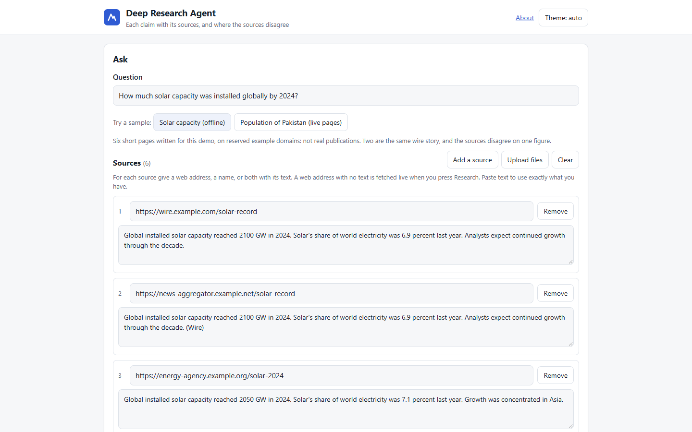
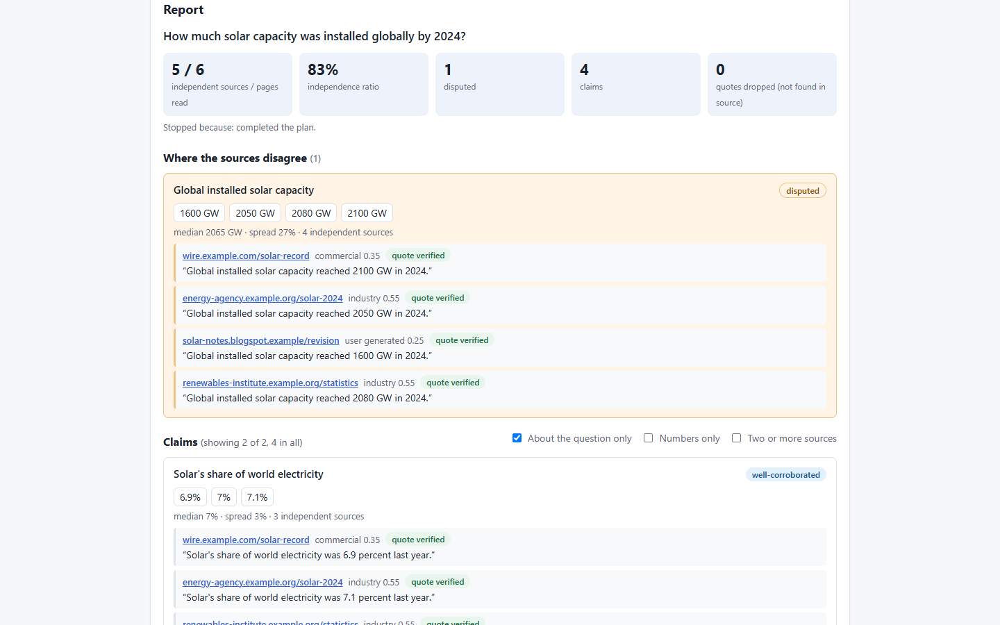
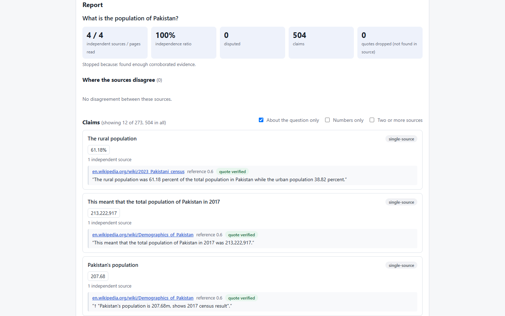
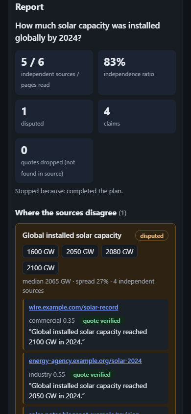

# deep-research-agent

[](https://github.com/hammasbuilds/deep-research-agent/actions/workflows/ci.yml)


[](LICENSE)

We built deep-research-agent, a research agent that tells you when its sources disagree
instead of quietly picking one. It plans queries (always including a contrary one), reads the
sources under a budget it cannot reason past, merges republished copies so one wire story is
not counted as ten sources, matches claims across sources, and checks every quote against the
text it came from. It ships with a small web page: ask a question, give it sources (pasted,
uploaded or fetched live from a URL) and read each claim with its sources and whether it is
corroborated or disputed. It is for anyone who needs research they can check, and for
developers who want a research loop that is testable with no network and no model.

## What it does

- **Plans** queries from the question, always adding a contrary-evidence query.
- **Searches and fetches** through functions you inject (`search(query, limit)`,
  `fetch(url)`), so any search API or a local index works, and the whole agent runs in tests
  with neither.
- **Merges copies** with hashed word shingles before counting anything; the copy from the most
  authoritative domain represents the group. A long sentence repeated word for word on two
  otherwise different pages also counts once.
- **Extracts claims**: numbers ("X was 8.2 percent", "reached 2100 GW", "estimated at $410
  billion") and stances ("X is not Y"), each with the whole sentence as its quote.
- **Corroborates**: figures within a tolerance agree (8.2% and 8.4%), figures further apart are
  **disputed** (8.2% and 12.4%) with both sides and both citations kept; the consensus is the
  median. Confidence comes from the number of independent sources: single-source,
  corroborated (2), well-corroborated (3+), or disputed.
- **Verifies every quote** against the fetched text (whitespace-insensitive, otherwise exact)
  and drops and counts any that are not found.
- **Ranks findings** by how much of the question they are about.
- **Stops** on a query, fetch or time budget enforced outside the loop, or as soon as it has
  enough corroborated evidence, and says which.
- **Web page** (`run.bat` or `python -m research.web`): question, sources (paste, upload
  `.txt`/`.md`/`.html`, or a URL fetched live), two sample sets, filters, a sources table that
  says what happened to each source, light and dark themes, works on a phone.

## Screenshots



Input: the "Solar capacity (offline)" sample, six short pages written for the demo on reserved
`example` domains. Output: the question and each source, ready to run.



Input: the same six pages. Output: six pages read as five independent sources (two were the
same wire story), installed capacity **disputed** at 1600 / 2050 / 2080 / 2100 GW (spread 27%)
with each quote verified in its source, and solar's share of electricity well-corroborated at
6.9 / 7 / 7.1%.



Input: "What is the population of Pakistan?" with four Wikipedia addresses and no text, so the
pages are fetched live (2026-10-17). Output: 504 claims from four independent sources, 273 of
them about the question; the top ones are the census figures with their sentences (61.18%
rural, 213,222,917 in 2017).



Input: the offline sample on a 390 px wide screen in dark mode. Output: the same disputed figure,
laid out in one column.

## Sample input / output

`python demo.py`, five pages written in the script (no network, no model):

```
OUTPUT
   5 pages -> 4 independent sources
      merged as one: news-a.example, news-b.example  (same text, republished)
   independence ratio 80%  (4 of 5 documents)

   DISAGREEMENT   Global installed solar capacity
      consensus   2080   spread 27.0%
          2100 gw   https://news-a.example/solar
          2100 gw   https://news-b.example/solar
          2050 gw   https://energy-agency.example.org/solar
          1600 gw   https://contrarian.example/solar
          2080 gw   https://renewables-institute.example.org/solar
```

As a library:

```python
from research import ResearchAgent, Source

def search(query, limit):  return my_search_api(query)[:limit]
def fetch(url):            return Source(url=url, text=download(url))

agent = ResearchAgent(search=search, fetch=fetch, min_authority=0.6)
report = agent.run("What is inflation in Pakistan?")

report.summary()
# {"findings": 2, "disputed": 1, "independent_sources": 3, "documents_fetched": 5,
#  "independence_ratio": 0.6, "unverified_quotes_dropped": 0,
#  "stopped_because": "found enough corroborated evidence"}
report.disputed   # both figures, the spread and a citation for each side
report.findings   # agreements, with confidence from corroboration and a relevance score
```

## Results

- 80 tests, no network, no API key, no model: authority classes, deduplication (copies collapse,
  the highest-authority copy represents the group, copied sentences count once), extraction
  (units, currency, commas, negation, line breaks, pronoun subjects), corroboration (agreement,
  dispute, tolerance, median consensus), planning, quote verification (a fabricated quote is
  rejected, a near miss is a miss), budgets and early stopping, and the web server (request
  checks, live fetch with a stub, every endpoint over HTTP).
- On the four live Wikipedia pages above, deduplication of whole pages found nothing to merge
  (4 of 4 independent), while 14 sentences repeated word for word between an article and its
  sub-articles (in 10 claims) were each counted once; before this, those claims were reported
  as corroborated by two sources.

## Tech stack

- Python 3.10+, zero runtime dependencies
- Standard library only: `re`, `hashlib` (blake2b shingles), `statistics`, `dataclasses`
- Web page: `http.server`, `urllib` for live fetches, `html.parser` for page text; vanilla
  HTML, CSS and JavaScript with no build step
- Optional extra `web` (`httpx`) for your own fetch function
- pytest, ruff, hatchling; GitHub Actions on Python 3.10 to 3.13

## Run it

```bash
git clone https://github.com/hammasbuilds/deep-research-agent
cd deep-research-agent

pip install -e .         # no dependencies
pytest -q                # 80 tests
python demo.py

python -m research.web --port 8845          # then open http://127.0.0.1:8845/
```

On Windows, `run.bat` starts the page (with `uv`): `run.bat --port 8845 --no-browser`.

- Search on the page runs over the sources you give it; it does not search the web. A source
  given only as a web address is fetched live (up to 3 MB, 15 s).
- Claim extraction uses sentence patterns, so a figure stated another way ("with a population of
  over 241 million") is not picked up; a model-based extractor can sit behind the same `Claim`
  interface.
- Domain authority is a coarse prior (primary research, official, press, reference, industry,
  commercial, user-generated, unknown); it orders sources and never makes a claim true.

## Licence

MIT, see [LICENSE](LICENSE). The live sample reads Wikipedia pages, whose text is CC BY-SA 4.0.
